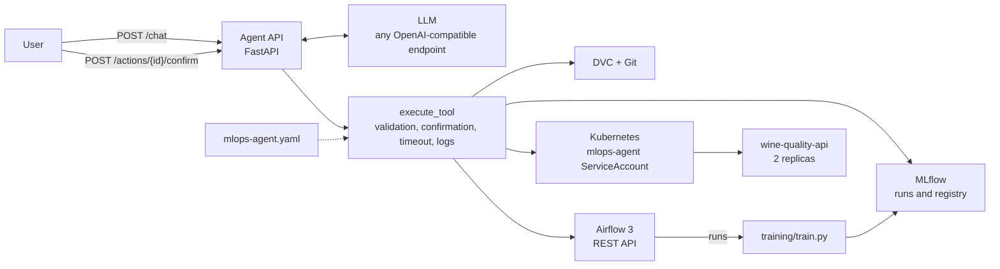

# Grounded MLOps Agent

Conversational AI agent for MLOps: traces dataset lineage (DVC), compares experiments (MLflow), runs training pipelines (Airflow) and diagnoses Kubernetes deployments, backing every answer with real tool evidence.

Ask a question in plain language. The agent calls tools against the real systems, then answers from what they returned, with the raw tool results attached as `evidence`. Anything that changes the system waits for a person to confirm it, through an endpoint the LLM cannot reach.

The agent isn't tied to one project. A config file, [`mlops-agent.yaml`](mlops-agent.yaml), says which experiment, model, DAGs and namespace to manage. This repo also contains a complete demo project for it to manage: a wine quality classifier with versioned data, a training pipeline, a model registry and a Kubernetes deployment.

```text
> Find the best recent model, identify the dataset version used to train it,
  check the deployment status, and explain whether retraining is necessary.

## Known facts
- Best run dd037273… has F1 0.4951 and passed the quality gate (get_best_run).
- It was trained on data-v2, hash verified against the DVC pointer (get_dataset_for_run).
- wine-quality-api runs model-v6, 2/2 replicas ready, rollout complete (get_deployed_version).
- No newer data, model 0 days old, gate passed (get_retraining_signals).
- No input drift; largest shift −0.21 std (check_prediction_drift).
## Uncertainties
- Live accuracy is unknown without true labels.
## Recommended actions
- No retraining warranted. The best-scoring run isn't the deployed one: review promotion.
```

The full exchange, with every tool result, is in [`reports/evidence/05-multi-tool.json`](reports/evidence/05-multi-tool.json).

## Architecture



| Component | Location |
|---|---|
| Project config | `mlops-agent.yaml`, loaded by `agent/config.py` |
| Tools: 25 across DVC, MLflow, Airflow, Kubernetes and drift monitoring | `agent/tools/` |
| Tool runner: validation, confirmation, timeouts, structured logs | `agent/registry.py` |
| Agent loop and system prompt | `agent/orchestrator.py` |
| LLM adapter | `agent/llm.py` |
| Chat API | `agent/main.py` |
| Demo project: training stages | `training/train.py` |
| Demo project: Airflow pipeline | `dags/training_pipeline.py`, `infra/airflow/Dockerfile` |
| Demo project: inference service | `api/main.py`, `Dockerfile` |
| Demo project: Kubernetes manifests and RBAC | `kubernetes/` (kustomize) |

See [`architecture.md`](architecture.md) for the request flow, data lineage, drift monitoring and permission layers.

## Installation

**Prerequisites:** Linux or macOS, Python 3.12, Docker with Compose, [minikube](https://minikube.sigs.k8s.io/), `kubectl`, `jq`, and an OpenAI-compatible LLM endpoint. The local setup used [llama.cpp](https://github.com/ggml-org/llama.cpp)'s `llama-server`.

```bash
git clone https://github.com/lioncovehx/grounded-mlops-agent.git
cd grounded-mlops-agent
python3.12 -m venv .venv
source .venv/bin/activate
pip install -e ".[dev]"
```

## Configuration

Two files: **`mlops-agent.yaml`** says *what* the agent manages, and **`.env`** holds *how to reach it*: URLs and credentials.

```bash
cp .env.example .env
```

| `.env` variable | Purpose |
|---|---|
| `LLM_BASE_URL`, `LLM_MODEL`, `LLM_API_KEY` | The LLM endpoint. See [Using your own LLM](#using-your-own-llm) |
| `MLFLOW_TRACKING_URI` | MLflow server, `http://localhost:5000` |
| `AIRFLOW_BASE_URL`, `AIRFLOW_USERNAME`, `AIRFLOW_PASSWORD` | Airflow API. The local stack uses `airflow` / `airflow` |
| `KUBECONFIG` | **Full path** to the agent's restricted kubeconfig. Quote it if the path has spaces |
| `MLOPS_AGENT_CONFIG` | Optional path to a project config; default `mlops-agent.yaml` in the repo root |
| `QUALITY_GATE_F1` | Demo training: minimum F1 for a model to become `candidate` |
| `AIRFLOW_UID` | Your user ID (`id -u`), so files the pipeline writes stay yours |
| `AIRFLOW__API_AUTH__JWT_SECRET`, `FERNET_KEY` | Random secrets for Airflow. Commands to generate them are in `.env.example` |

Optional: `TOOL_TIMEOUT_S` (default 30) and `LLM_TIMEOUT_S` (300).

## Using the agent with your own project

Write a `mlops-agent.yaml` for your project (or point `MLOPS_AGENT_CONFIG` at one). Every key is optional. Without a value, tools fall back to generic defaults, discover what they can, or ask for it as an argument. Unknown keys are rejected, so typos fail loudly.

| Section | Keys | Used for |
|---|---|---|
| `dvc` | `repo_dir`, `version_tag_pattern`, `default_dataset` | Datasets are discovered from tracked `.dvc` files; versions are Git tags matching the pattern |
| `mlflow` | `experiment`, `registered_model`, `primary_metric`, `aliases`, `tags`, `model_max_age_days`, `feature_stats_artifact` | Defaults for run, registry and retraining tools. Metrics are discovered from runs |
| `airflow` | `default_dag`, `allowed_dags` | The only DAGs the agent may trigger |
| `kubernetes` | `namespace`, `default_deployment`, `pod_selector`, `model_version_label` | The only namespace the agent may touch |
| `monitoring` | `prediction_event`, `drift_threshold_std`, `min_predictions` | Drift check |

Listing runs, DAGs, Pods and services works on any project straight away. The lineage, retraining and drift features need your project to follow this **integration contract**. Anything missing is reported as "not available", never guessed:

1. **Provenance tags on each MLflow run** (names configurable in `mlflow.tags`): data hash, data version tag, data commit, data path, code commit, quality gate result.
2. **A `source_run` tag on each registered model version**, and an alias for the deployed version (`champion` by default).
3. **A `feature_stats.json` artifact on each training run:** `{"features": {"<name>": {"mean": ..., "std": ...}}, "label_positive_rate": ...}`.
4. **One JSON log line per prediction** from the inference service: `{"event": "prediction", "model_version": ..., "features": {...}, "prediction": ...}`.
5. **A model version label** on the Deployment's Pod template (`mlops/model-version` by default).
6. **A restricted ServiceAccount** like `kubernetes/rbac.yaml`: read access plus `patch` on Deployments, in one namespace.

`training/train.py`, `api/main.py` and `kubernetes/` in this repo are a working example of every point.

## Launching the demo project

**1. Data.** The DVC remote is local to the author's machine, so rebuild the data from the UCI files (see [Data](#data)):

```bash
python data/build_dataset.py v2 --source <folder with the UCI CSV files> --out data/raw/wine.csv
dvc repro
```

**2. MLflow and Airflow,** in one Compose stack (project `grounded-mlops`). The first build takes several minutes.

```bash
docker compose build
docker compose up airflow-init      # wait for "exited with code 0"
docker compose up -d
```

MLflow is at http://localhost:5000, and Airflow at http://localhost:8080. New DAGs start paused, so unpause `training_pipeline` in the UI or through the API, then trigger it.

**3. Kubernetes and the inference service.** Promote the gate-approved model, build its image, and deploy:

```bash
export MLFLOW_TRACKING_URI=http://localhost:5000
V=$(python - <<'EOF'
import mlflow
from mlflow import MlflowClient
c = MlflowClient()
v = c.get_model_version_by_alias("wine-quality", "candidate")
mlflow.artifacts.download_artifacts(run_id=v.tags["source_run"], artifact_path="model.joblib", dst_path="model")
c.set_registered_model_alias("wine-quality", "champion", v.version)
print(v.version)
EOF
)
docker build --build-arg MODEL_VERSION=$V -t wine-quality-api:model-v$V .
minikube start -p mlops --driver=docker --container-runtime=containerd
minikube -p mlops image load wine-quality-api:model-v$V
kubectl apply -k kubernetes/
kubectl -n wine-quality rollout status deployment/wine-quality-api
```

The image tag and the `mlops/model-version` label are both set in `kubernetes/kustomization.yaml`. Change them together when you ship a new version.

**4. The agent's restricted credentials.** The minikube kubeconfig is cluster admin, so the agent gets its own:

```bash
kubectl config view --raw --minify --flatten > kubeconfig.agent && chmod 600 kubeconfig.agent
TOKEN=$(kubectl -n wine-quality create token mlops-agent --duration=24h)
kubectl --kubeconfig kubeconfig.agent config set-credentials mlops-agent --token="$TOKEN"
kubectl --kubeconfig kubeconfig.agent config set-context --current --user=mlops-agent --namespace=wine-quality
kubectl --kubeconfig kubeconfig.agent config unset users.mlops
```

Set `KUBECONFIG` in `.env` to this file's full path. The token expires, so repeat the `create token` and `set-credentials` lines when it does.

**5. The LLM,** for example locally:

```bash
llama-server -m <model.gguf> --jinja -ngl 99 -c 32000 --port 8081
```

`--jinja` is required for tool calling.

**6. The agent:**

```bash
set -a; source .env; set +a
uvicorn agent.main:app --port 8001
```

Interactive API docs are at http://localhost:8001/docs.

## Interacting with the agent

```bash
curl -s localhost:8001/chat -H 'Content-Type: application/json' \
  -d '{"message": "Why did the latest training run fail?"}' | jq
```

Every response has `answer`, `evidence` (one envelope per tool call: `tool`, `status`, `data`, `error`, `duration_ms`, `request_id`), `request_id`, and `pending_action_id`.

**Confirming changes.** Restarting a deployment and triggering a pipeline never run straight from a chat. The response carries a `pending_action_id` instead:

```bash
curl -s -X POST localhost:8001/actions/<pending_action_id>/confirm | jq   # runs it, once
curl -s -X POST localhost:8001/actions/<pending_action_id>/cancel         # discards it
```

Pending actions expire after 5 minutes.

## Monitoring for drift

`check_prediction_drift` reads the prediction log lines from the inference Pods, and compares the inputs with the deployed model's `feature_stats.json`, found through the `champion` alias. It reports each feature's mean shift in training standard deviations, flags shifts over 0.5, and needs at least 30 predictions before giving a verdict. Pods without readable logs, such as one stuck pulling an image, are skipped and listed.

To try it, port-forward the Service, send traffic, then ask the agent:

```bash
kubectl -n wine-quality port-forward svc/wine-quality-api 8000:80 &
python scripts/send_traffic.py normal --n 60    # real rows: no drift
python scripts/send_traffic.py skewed --n 60    # residual sugar tripled: drift
```

## Using your own LLM

The agent speaks the OpenAI chat-completions format, which llama.cpp, vLLM, Ollama, OpenAI and many hosted providers support. Change only these three settings:

```bash
LLM_BASE_URL=https://api.openai.com/v1
LLM_MODEL=<a model with tool calling>
LLM_API_KEY=<your key>
```

The model must support tool calling. The system prompt is sent once, as the first message.

## Running the tests

```bash
pytest -m "not integration"
ruff check . && ruff format --check .
```

The tests replace the LLM with scripted replies, mock each service at its client, and use a test config (`tests/agent-test.yaml`) whose names differ from the demo project, so they need no running services. GitHub Actions runs lint and tests on every pull request (`.github/workflows/ci.yml`).

## Data

Uses the Wine Quality dataset by P. Cortez, A. Cerdeira, F. Almeida, T. Matos and J. Reis,
from the UCI Machine Learning Repository, licensed under CC BY 4.0:
https://archive.ics.uci.edu/dataset/186/wine+quality

Two versions are tracked with DVC and tagged in Git:

| Tag | Contents | Rows |
|---|---|---|
| `data-v1` | Red wine | 1,599 |
| `data-v2` | Red and white wine | 6,497 |

The DVC remote is local to the author's machine, so `dvc pull` won't work on a fresh clone.
Rebuild the data from the UCI files instead:

```bash
python data/build_dataset.py v2 --source <folder with the UCI CSV files> --out data/raw/wine.csv
```

The model predicts whether a wine is good (quality 7 or above), with duplicates removed before an 80/20 stratified split. A random forest reaches F1 of about 0.49 on `data-v2`.

## Known limitations

- **Local, single-node setup.** minikube and Docker Compose, with default Airflow credentials. Not hardened for shared use.
- **Local DVC remote.** A fresh clone rebuilds the data instead of pulling it.
- **One train/test split** and a small dataset. The F1 scores are indicative, not tuned.
- **Pending actions are in memory.** They're lost on restart and work only with a single process.
- **Short-lived Kubernetes token.** It has to be recreated when it expires.
- **No live accuracy.** Input drift is measured from prediction logs, but accuracy in production needs true labels, which the system doesn't receive. Prediction logs also reset when Pods restart.
- **No promotion tool.** The agent reports `candidate` and `champion` but can't move them; promotion and deployment are manual (step 3).
- **LLM judgement varies.** Facts come from tools, and code adds a note when a tool fails, but which tools the model chooses, and its inferences, can still be wrong. See the report's "Agent errors observed".
