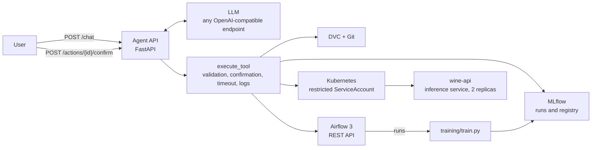

# Grounded MLOps Agent

Conversational AI agent for MLOps: traces dataset lineage (DVC), compares experiments (MLflow), runs training pipelines (Airflow) and diagnoses Kubernetes deployments, backing every answer with real tool evidence.

Ask a question in plain language. The agent calls tools against the real systems, then answers from what they returned, with the raw tool results attached as `evidence`. Anything that changes the system waits for a person to confirm it, through an endpoint the LLM cannot reach.

```text
> Find the best recent model, identify the dataset version used to train it,
  check the deployment status, and explain whether retraining is necessary.

## Known facts
- Best run dd037273… has F1 0.4951 and passed the quality gate (get_best_run).
- It was trained on data-v2, md5 3e3353d2…, verified against the DVC pointer (get_dataset_for_run).
- wine-api runs model version 4 with 2/2 replicas ready; rollout complete (get_deployed_version).
- The latest pipeline run failed at validate_dataset (get_dag_run_status).
- The champion was trained on the current data and is 0 days old (get_retraining_signals).
## Uncertainties
- No production metrics are available, so degradation can't be assessed.
## Recommended actions
- Retraining isn't indicated by the available signals. Investigate the failed pipeline run.
```

The full exchange, with every tool result, is in [`reports/evidence/05-multi-tool.json`](reports/evidence/05-multi-tool.json).

## Architecture



| Component | Location |
|---|---|
| Training stages: validate, preprocess, train, evaluate, gate | `training/train.py` |
| Airflow pipeline | `dags/training_pipeline.py`, `infra/airflow/Dockerfile` |
| Inference service | `api/main.py`, `Dockerfile` |
| Kubernetes manifests and RBAC | `kubernetes/` |
| Tools: 24 across four systems | `agent/tools/` |
| Tool runner: validation, confirmation, timeouts, structured logs | `agent/registry.py` |
| Agent loop and system prompt | `agent/orchestrator.py` |
| LLM adapter | `agent/llm.py` |
| Chat API | `agent/main.py` |

See [`architecture.md`](architecture.md) for the request flow, data lineage and permission layers.

## Installation

**Prerequisites:** Linux or macOS, Python 3.12, Docker with Compose, [minikube](https://minikube.sigs.k8s.io/), `kubectl`, `jq`, and an OpenAI-compatible LLM endpoint. The local setup used [llama.cpp](https://github.com/ggml-org/llama.cpp)'s `llama-server`.

```bash
git clone https://github.com/lioncovehx/grounded-mlops-agent.git
cd grounded-mlops-agent
python3.12 -m venv .venv
source .venv/bin/activate
pip install -e ".[dev]"
```

## Configuration

```bash
cp .env.example .env
```

| Variable | Purpose |
|---|---|
| `LLM_BASE_URL`, `LLM_MODEL`, `LLM_API_KEY` | The LLM endpoint. See [Using your own LLM](#using-your-own-llm) |
| `MLFLOW_TRACKING_URI` | MLflow server, `http://localhost:5000` |
| `AIRFLOW_BASE_URL`, `AIRFLOW_USERNAME`, `AIRFLOW_PASSWORD` | Airflow API. The local stack uses `airflow` / `airflow` |
| `KUBECONFIG` | **Full path** to the agent's restricted kubeconfig. Quote it if the path has spaces |
| `AGENT_ALLOWED_NAMESPACE` | The only namespace the Kubernetes tools may touch |
| `AGENT_ALLOWED_DAGS` | Comma-separated DAGs the agent may trigger |
| `QUALITY_GATE_F1` | Minimum F1 for a model to be registered as `candidate` |
| `AIRFLOW_UID` | Your user ID (`id -u`), so files the pipeline writes stay yours |
| `AIRFLOW__API_AUTH__JWT_SECRET`, `FERNET_KEY` | Random secrets for Airflow. Commands to generate them are in `.env.example` |

Optional: `TOOL_TIMEOUT_S` (default 30), `LLM_TIMEOUT_S` (300) and `MODEL_MAX_AGE_DAYS` (30).

## Launching the services

**1. Data.** The DVC remote is local to the author's machine, so rebuild the data from the UCI files (see [Data](#data)):

```bash
python data/build_dataset.py v2 --source <folder with the UCI CSV files> --out data/raw/wine.csv
dvc repro
```

**2. MLflow and Airflow,** in one Compose stack. The first build takes several minutes.

```bash
docker compose build
docker compose up airflow-init      # wait for "exited with code 0"
docker compose up -d
```

MLflow is at http://localhost:5000, and Airflow at http://localhost:8080. New DAGs start paused, so unpause `training_pipeline` in the UI or through the API, then trigger it.

**3. Kubernetes and the inference service.**

```bash
export MLFLOW_TRACKING_URI=http://localhost:5000
# Fetch the candidate model and record it as champion
python - <<'EOF'
import mlflow
from mlflow import MlflowClient
c = MlflowClient()
v = c.get_model_version_by_alias("wine-quality", "candidate")
mlflow.artifacts.download_artifacts(run_id=v.tags["source_run"], artifact_path="model.joblib", dst_path="model")
c.set_registered_model_alias("wine-quality", "champion", v.version)
print(v.version)
EOF

docker build --build-arg MODEL_VERSION=<version> -t wine-api:0.1.0 .
minikube start -p mlops --driver=docker --container-runtime=containerd
minikube -p mlops image load wine-api:0.1.0
kubectl apply -f kubernetes/namespace.yaml && kubectl apply -f kubernetes/
kubectl -n mlops-app rollout status deployment/wine-api
```

Set the `model-version` label in `kubernetes/deployment.yaml` to the same version.

**4. The agent's restricted credentials.** The minikube kubeconfig is cluster admin, so the agent gets its own:

```bash
kubectl config view --raw --minify --flatten > kubeconfig.agent && chmod 600 kubeconfig.agent
TOKEN=$(kubectl -n mlops-app create token agent --duration=24h)
kubectl --kubeconfig kubeconfig.agent config set-credentials agent --token="$TOKEN"
kubectl --kubeconfig kubeconfig.agent config set-context --current --user=agent --namespace=mlops-app
kubectl --kubeconfig kubeconfig.agent config unset users.mlops
```

Set `KUBECONFIG` in `.env` to this file's full path. The token expires, so repeat the `create token` and `set-credentials` lines when it does.

**5. The LLM,** for example locally:

```bash
llama-server -m <model.gguf> --jinja -ngl 99 -c 32000 --port 8081
```

`--jinja` is required for tool calling.

**6. The agent:**

```bash
set -a; source .env; set +a
uvicorn agent.main:app --port 8001
```

Interactive API docs are at http://localhost:8001/docs.

## Interacting with the agent

```bash
curl -s localhost:8001/chat -H 'Content-Type: application/json' \
  -d '{"message": "Why did the latest training_pipeline run fail?"}' | jq
```

Every response has `answer`, `evidence` (one envelope per tool call: `tool`, `status`, `data`, `error`, `duration_ms`, `request_id`), `request_id`, and `pending_action_id`.

**Confirming changes.** Restarting a deployment and triggering a pipeline never run straight from a chat. The response carries a `pending_action_id` instead:

```bash
curl -s -X POST localhost:8001/actions/<pending_action_id>/confirm | jq   # runs it, once
curl -s -X POST localhost:8001/actions/<pending_action_id>/cancel         # discards it
```

Pending actions expire after 5 minutes.

## Using your own LLM

The agent speaks the OpenAI chat-completions format, which llama.cpp, vLLM, Ollama, OpenAI and many hosted providers support. Change only these three settings:

```bash
LLM_BASE_URL=https://api.openai.com/v1
LLM_MODEL=<a model with tool calling>
LLM_API_KEY=<your key>
```

The model must support tool calling. The system prompt is sent once, as the first message.

## Running the tests

```bash
pytest -m "not integration"
ruff check . && ruff format --check .
```

The tests replace the LLM with scripted replies and mock each service at its client, so they need no running services. GitHub Actions runs lint and tests on every pull request (`.github/workflows/ci.yml`).

## Data

Uses the Wine Quality dataset by P. Cortez, A. Cerdeira, F. Almeida, T. Matos and J. Reis,
from the UCI Machine Learning Repository, licensed under CC BY 4.0:
https://archive.ics.uci.edu/dataset/186/wine+quality

Two versions are tracked with DVC and tagged in Git:

| Tag | Contents | Rows |
|---|---|---|
| `data-v1` | Red wine | 1,599 |
| `data-v2` | Red and white wine | 6,497 |

The DVC remote is local to the author's machine, so `dvc pull` won't work on a fresh clone.
Rebuild the data from the UCI files instead:

```bash
python data/build_dataset.py v2 --source <folder with the UCI CSV files> --out data/raw/wine.csv
```

The model predicts whether a wine is good (quality 7 or above), with duplicates removed before an 80/20 stratified split. A random forest reaches F1 of about 0.49 on `data-v2`.

## Known limitations

- **Local, single-node setup.** minikube and Docker Compose, with default Airflow credentials. Not hardened for shared use.
- **Local DVC remote.** A fresh clone rebuilds the data instead of pulling it.
- **One train/test split** and a small dataset. The F1 scores are indicative, not tuned.
- **Pending actions are in memory.** They're lost on restart and work only with a single process.
- **Short-lived Kubernetes token.** It has to be recreated when it expires.
- **No production metrics.** The agent can't judge degradation in live traffic, and says so.
- **LLM judgement varies.** Facts come from tools, and code adds a note when a tool fails, but which tools the model chooses, and its inferences, can still vary between runs.
