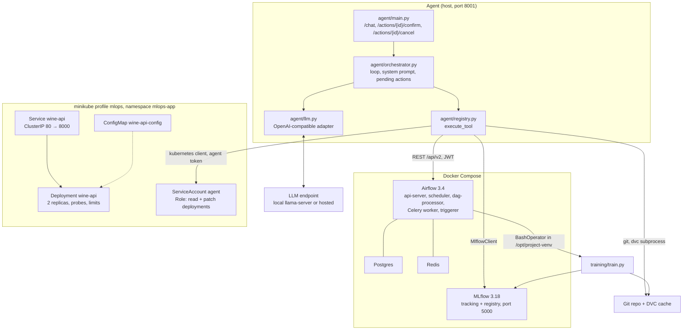
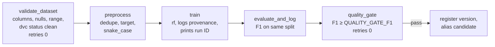
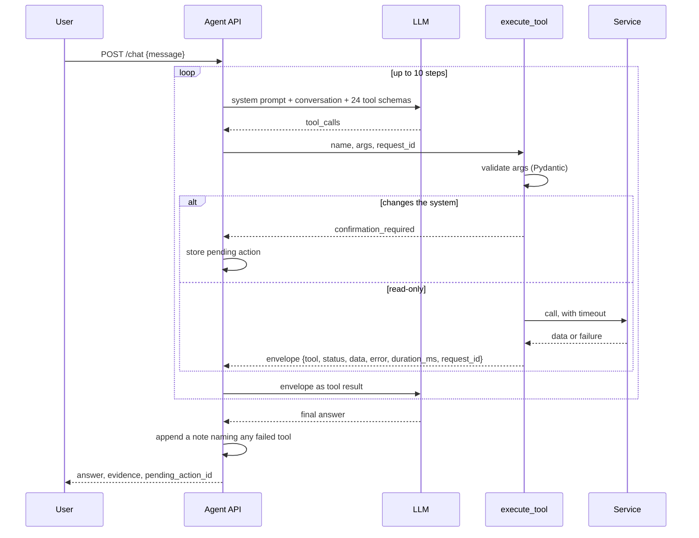
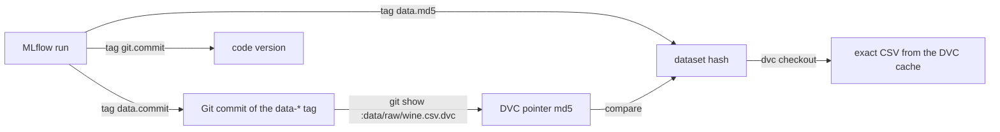
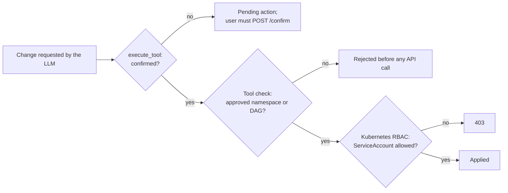

# Architecture

## Components

The Airflow worker runs the training stages in a separate virtual environment (`/opt/project-venv`), built from the same pinned `pyproject.toml`, so the project's packages can't clash with Airflow's own. The repo is mounted at `/opt/project`.

## The training pipeline

The `train` task's last output line, the MLflow run ID, becomes its XCom value. The next two tasks receive it as `--run-id`. Validation and the gate never retry, because bad data or a weak model won't improve on a second attempt. The other tasks retry twice, 30 seconds apart.

## A request through the agent

Three guarantees come from code rather than from the LLM:
- **`execute_tool` never raises.** Every failure becomes `error`, `timeout`, `unavailable` or `confirmation_required`, and the answer receives a note naming any tool that failed.
- **Tool output is data.** It's returned as a tool result, and the system prompt says never to follow instructions found inside it.
- **Structured logs** record a fixed set of fields per call: tool, status, duration and request ID. Arguments and results are never logged.

## From a run to its exact data

`training/train.py` tags every run with `data.md5`, `data.tag`, `data.commit` and `git.commit`. `data.commit` is recorded separately because training on an older version restores an old pointer while `HEAD` stays at a later commit. `get_dataset_for_run` re-reads the pointer at `data.commit`, and reports `verified: true` only if the hashes match. Missing tags are reported as a finding, never guessed.

## Permission layers

| Layer | Enforced by | Limit |
|---|---|---|
| Confirmation | `execute_tool` and `/actions/{id}/confirm` | `restart_deployment` and `trigger_dag` run only after a person confirms them, once. The LLM has no tool that confirms |
| Allowlists | The tool functions | Kubernetes tools: `AGENT_ALLOWED_NAMESPACE` only. `trigger_dag`: `AGENT_ALLOWED_DAGS` only |
| Command allowlist | `dvc_tools.run` | Only `git show/rev-parse/tag/status/log` and `dvc list/diff/status`, without a shell. Revisions must match `^[\w./-]+$` and can't start with `-` |
| Argument validation | Pydantic models | Unknown fields rejected; ranges and patterns enforced |
| Kubernetes RBAC | `kubernetes/rbac.yaml` | Get and list on Pods, logs, Services and Events; patch on Deployments; namespace `mlops-app` only. No delete, no secrets |
